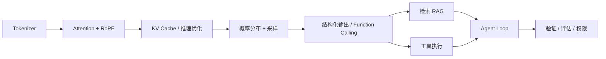

# 01 · LLM 底座

> Agent 的所有行为，都建立在「一个按概率续写 token 的函数」之上。
> 这一章不追求会训模型，只追求：**知道模型在算什么、钱花在哪、为什么会胡说**。

---

## 1. 先建立心智模型

```
输入 token 序列 ──► 神经网络 ──► 下一个 token 的概率分布 ──► 采样 ──► 追加 ──► 重复
```

三个必须记住的事实：

1. **模型不「查知识」，它在续写。** 参数里的知识是压缩过的、有损的、会过时的。
2. **模型不「执行」任何东西。** Function Calling 只是按 schema 输出了一段结构化文本，执行永远在你的代码里。
3. **采样带来不确定性。** `temperature=0` 只是贪心解码，不等于事实正确；对齐目标还会鼓励模型「自信地给出答案」，而不是说不知道。

**由此推出整个 Agent 工程的意义**：用外部系统（检索、工具、验证、循环、权限）去约束一个概率模型，把「可能答对」变成「可验证地完成任务」。

---

## 2. 核心知识点

### 2.1 Tokenization：一切成本与怪异 bug 的起点

- 主流是 **BPE / byte-level BPE**：按子词切分，词表大小决定序列长度。
- 中文、数字、代码、emoji 的 token 数往往超出直觉；「9.11 > 9.9」这类错误部分源于数字被切开。
- 上下文窗口、计费、延迟全都按 **token** 算，不按字数算。
- 面试延伸：为什么换 tokenizer 后必须重新建向量索引？因为 embedding 模型的输入分布变了。

### 2.2 Attention：QKV 与那个 √d_k

```
Attention(Q, K, V) = softmax(QKᵀ / √d_k + mask) · V
```

- **Q** 是「我在找什么」，**K** 是「我有什么可被匹配」，**V** 是「匹配后要取出的内容」。
- **除以 √d_k**：`d_k` 变大时点积方差变大，softmax 会饱和到接近 one-hot，梯度消失；缩放让数值回到合理区间。
- **因果掩码**：decoder-only 模型只能看当前位置之前，这是「自回归」的实现方式。
- **MHA → GQA → MQA**：多个 Q 头共享 K/V 头，主要目的是**压缩 KV Cache 显存**，不是为了提升效果。
- **RoPE**：旋转位置编码，相对位置信息、有一定长度外推能力，是当代长上下文模型的默认选择。
- **O(n²) 复杂度**：长上下文变贵是第一层代价；注意力被大量无关 token 稀释（context rot / lost-in-the-middle）是第二层代价，见 [04 章](../04-memory-and-context/README.md)。

### 2.3 KV Cache：为什么长对话又慢又贵

- 生成第 t 个 token 时，前面所有 token 的 K、V 已经算过，缓存下来就不用重算 → prefill 一次，decode 逐步。
- 显存近似 `2 × layers × kv_heads × head_dim × seq_len × bytes`，随序列**线性**增长，是长任务的主要瓶颈。
- **PagedAttention**（vLLM）借鉴操作系统分页管理 KV 块，减少碎片；**连续批处理**让请求陆续进出，提高吞吐。
- **投机解码**：小模型先草稿一批 token，大模型一次并行验证，用算力换延迟。
- 面试指标要分清：**TTFT**（首 token 延迟，用户体验）、**TPOT**（每 token 延迟）、**吞吐**（tokens/s，成本）。

### 2.4 采样与结构化输出

| 参数 | 作用 | 常见误解 |
|---|---|---|
| `temperature` | 缩放 logits，控制分布平坦程度 | 0 不等于「不幻觉」，只等于「取最大概率」 |
| `top_p` / `top_k` | 截断候选集合 | 与 temperature 同时大幅调整容易互相干扰 |
| `max_tokens` | 硬上限 | 输出被截断会导致 JSON 解析失败，是生产事故常见来源 |
| `seed` | 尽量可复现 | 批处理/浮点非确定性下不保证完全一致 |

**Function Calling / JSON mode 的真相**（面试高频）：

```
工具 schema ──► 拼进上下文 + 训练时学过这种格式 ──► 解码阶段用 JSON Schema / 语法约束
            ──► 模型输出 {"name": "...", "arguments": {...}} ──► 你的代码解析并执行
```

模型从来没调用过函数。所以：参数非法、缺字段、类型错、幻觉出不存在的工具名，都是**概率事件**，必须在工程层做校验、重试与降级（见 [03 章](../03-tools-and-protocols/README.md)）。

### 2.5 训练与对齐

| 阶段 | 数据 | 解决什么 |
|---|---|---|
| 预训练 | 海量无标注文本 | 语言与世界知识，next-token prediction |
| SFT | 高质量指令 / 对话 | 学会「按指令回答」的格式 |
| RLHF | 人类偏好排序 → 奖励模型 → PPO | 对齐有用性与无害性，链路长且不稳定 |
| DPO | 偏好对（chosen / rejected） | 跳过奖励模型和 RL 循环，直接优化偏好，简单稳定 |
| GRPO | 组内采样相对奖励 | 推理 / 数学类模型的常用做法 |

一句话选型：**学知识靠预训练/RAG，学格式与风格靠微调，学「该拒答时拒答」靠对齐。**

### 2.6 参数高效微调

- **LoRA**：冻结 `W`，只训练低秩增量 `ΔW = B·A`（`r ≪ d`）。背后的假设是「任务适配的权重更新是低秩的」。可调 `r`、`alpha`、target modules；适配器可合并、可热插拔。
- **QLoRA**：把冻结的基座量化到 4-bit（NF4）再挂 LoRA，单张消费卡也能微调大模型。
- **RAG vs 微调**：知识频繁更新、需要溯源 → RAG；要固定输出风格、领域行为、降低延迟 → 微调；两者可以组合（先微调定风格，再 RAG 供事实）。

### 2.7 推理部署

| 手段 | 原理 | 代价 |
|---|---|---|
| 量化 INT8 / INT4 / FP8 | 降低权重精度，减小显存带宽压力 | 轻微精度损失 |
| GPTQ / AWQ / bitsandbytes | 训练后量化 / 训练友好量化 | 需按硬件与场景选 |
| PagedAttention + 连续批处理 | 分页管理 KV、动态组批 | 主要提升吞吐 |
| 投机解码 | 小模型草稿、大模型验证 | 增加算力换低延迟 |
| 蒸馏 | 大模型教小模型 | 能力上限下降 |

### 2.8 上下文窗口：有效长度 ≠ 标称长度

标注 200K 不代表能「用好」200K。中间位置的信息容易被忽略（lost-in-the-middle），无关内容会稀释注意力（context rot）。
这正是 [04 章](../04-memory-and-context/README.md) 存在的理由：**上下文是预算，不是容器。**

---

## 3. 一张图：从 token 到 Agent



左边是「模型能力」，右边是「工程约束」。Agent 岗位考的绝大部分内容在右半边。

---

## 4. 易错点与面试陷阱

| 常见错答 | 更准确的回答 |
|---|---|
| 「Function Calling 是模型调用了函数」 | 模型只生成结构化参数，执行在应用层；训练 + 解码约束保证格式 |
| 「temperature=0 就不会幻觉」 | 只保证贪心解码；幻觉根源是训练数据、续写机制与对齐目标 |
| 「上下文越长越好」 | 长上下文带来 O(n²) 算力、KV Cache 显存、注意力稀释三重代价 |
| 「LoRA 就是少训点参数」 | 要能讲低秩假设、`ΔW=BA`、r/alpha、可合并与热插拔、与全量微调的质量差异 |
| 「RAG 和微调二选一」 | 按「知识 vs 行为」「更新频率」「是否需溯源」分，常组合使用 |
| 「GQA 是为了提升效果」 | 主要是压缩 KV Cache 显存、提升长上下文推理效率 |

---

## 5. 动手任务

1. 手算一次 `softmax(QKᵀ/√d_k)`，对比不缩放时 softmax 的饱和程度。
2. 用 `transformers` 加载一个小模型，打印 `past_key_values` 的形状，验证它随 `seq_len` 线性增长。
3. 同一个问题分别用 `temperature=0` 和 `0.8` 问 5 次，统计「自信但错误」的答案比例。
4. 给模型一个 JSON Schema，故意在 schema 里放一个易混字段，观察结构化输出的失败模式。

> 本章不配代码文件：这些实验用十几行 `transformers` / `openai` 调用即可，重点是亲手观察，而不是抄实现。

---

## 6. 高频面试题（附答题要点）

1. **Attention 为什么要除以 √d_k？**
   → 点积方差随 d_k 增大而增大 → softmax 饱和 → 梯度消失；缩放稳定数值。
2. **MHA / GQA / MQA 的区别？为什么现在多用 GQA？**
   → Q 头数不变，逐步减少 K/V 头；主要收益是 KV Cache 显存与推理带宽，效果损失很小。
3. **KV Cache 是什么？为什么长任务是显存瓶颈？**
   → 缓存历史 K/V 避免重算；占用 ≈ 层数 × kv_heads × head_dim × 序列长 × 2 × 精度字节。
4. **RoPE 相比绝对位置编码好在哪？**
   → 相对位置建模、外推性更好、无需额外参数。
5. **Function Calling 的完整链路？**
   → schema 注入 → 模型受约束解码出 JSON → 应用校验 → 执行 → 结果作为 tool message 回填 → 再次推理。
6. **模型返回非法参数怎么办？**
   → Schema 校验 + 明确错误信息回填让模型自修正 + 有限重试 + 兜底降级；不要无限重试。
7. **RLHF 三阶段？DPO 为什么更简单？**
   → SFT → 奖励模型 → PPO；DPO 用偏好对直接构造损失，去掉 RM 与在线采样循环。
8. **LoRA 的低秩假设是什么？r 怎么选？**
   → 适配所需更新位于低维子空间；r 小则省但表达受限，常用 8–64，配合 alpha 缩放与目标层选择。
9. **QLoRA 相比 LoRA 多了什么？**
   → 4-bit NF4 量化冻结基座 + 双重量化 + 分页优化器，显存大幅下降。
10. **RAG、微调、长上下文怎么选？**
    → 看知识更新频率、是否需溯源、是「缺知识」还是「缺行为」、成本与延迟；长上下文不消除检索需求。
11. **vLLM 为什么快？**
    → PagedAttention 减少 KV 碎片 + 连续批处理提高 GPU 利用率；区分吞吐与 TTFT。
12. **为什么上下文变长后效果反而变差？**
    → 注意力稀释 / 中间信息丢失 / 指令位置敏感，不只是成本问题 → 引出上下文工程。
13. **Temperature、top_p 有什么区别？调参怎么配合？**
    → 一个缩放分布、一个截断候选集；一般只动一个，避免叠加导致不可控。
14. **幻觉能彻底消除吗？**
    → 不能；目标是「降低发生率 + 可识别 + 可兜底」：检索门控、引用核查、结构化溯源、拒答路径。

---

## 7. 本章必须记住的三句话

1. **模型在续写 token，不在查数据库、更不在执行函数。**
2. **Function Calling 是受约束的结构化生成，执行永远在应用层。**
3. **上下文是有限预算：变长会让效果变差，不只是变贵。**
