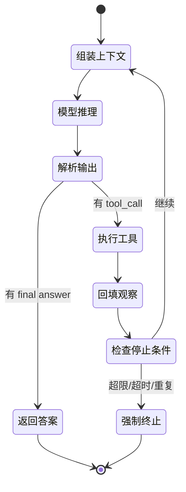

# 02 · Agent 核心

> 一个 `while` 循环 + 工具 + 停止条件，就是最小可用 Agent。
> 这一章的目标是：**合上文档能徒手写出它，并说清每一行为什么存在。**

---

## 1. 先建立心智模型：Agent vs Workflow

Anthropic 的经典区分，判断标准只有一条 —— **下一步由谁决定**：

| | Workflow | Agent |
|---|---|---|
| 路径 | 代码预先写死 | 模型在运行时动态决定 |
| 控制流 | `if/else`、DAG、图 | LLM 自主选择工具与步数 |
| 优点 | 可预测、可测、成本低 | 灵活、能处理未知路径 |
| 代价 | 覆盖不了未预见的分支 | 延迟、成本、不可预测性上升 |
| 典型场景 | 固定报表流水线、分类→模板生成 | 开放域调研、代码修复、多源分析 |

**判定口诀：路径确定用 Workflow，路径不确定才用 Agent。**
OpenAI 给的「值得上 Agent」三条件：复杂决策、规则难以硬编码维护、重度依赖非结构化数据。三条都不满足，就别上。

> 面试高频追问：「什么时候不该用 Agent？」——答不出这一问，基本会被判定为只会调框架。

### 增强型 LLM（augmented LLM）

Agent 的基本积木 = 模型 + 检索 + 工具 + 记忆，且模型能**主动决定**何时用它们。
Lilian Weng 的三分法（规划 / 记忆 / 工具使用）至今仍是描述 Agent 架构的通用词汇。

---

## 2. Agent Loop：最小完整实现的状态机

一个 loop 必须包含的五件事（**面试常问「除了工具调用还必须实现什么」**）：

1. **消息状态**：system / user / assistant / tool 四类角色的有序列表（`messages` 就是短期记忆的全部）。
2. **输出解析与校验**：工具名是否存在、参数是否符合 Schema、解析失败怎么处理。
3. **观察回填**：工具结果以 `role=tool` 追加，带 `tool_call_id` 对应。
4. **停止条件**：模型给出 final answer **或** 触发工程侧硬约束。
5. **可观测性**：记录每一轮的 prompt、工具、参数、耗时、token，否则线上无法定位问题。

### 停止条件的三层防护

| 层 | 机制 | 解决什么 |
|---|---|---|
| 语义层 | 显式 `FINISH` / final answer 输出格式 | 正常结束 |
| 行为层 | 重复动作检测（同工具 + 同参数连续 N 次）、无进展检测、目标达成校验 | 模型绕圈、反复查同一页 |
| 资源层 | 最大轮次、总超时、token/成本预算、熔断 | 兜底，防止跑飞 |

**只靠 `max_turns` 是常见错答**：它能在第 20 轮停住，但前 19 轮的钱已经烧完了，而且用户拿到的是失败而非答案。

---

## 3. 推理范式：一张演进表

| 范式 | 核心思想 | 适用 | 代价 / 缺陷 |
|---|---|---|---|
| **CoT** | 显式写出中间推理步骤 | 单次推理题 | 无外部纠错，第一步错就一路错下去 |
| **ReAct** | Thought → Action → Observation 交错 | 需要外部信息的多步任务 | 每步都调模型，延迟与成本线性增长；容易局部贪心 |
| **ToT** | 树状展开多条思路 + 自我评估选优 | 搜索空间小的规划题 | 调用次数爆炸 |
| **Reflexion** | 失败后写「语言反思」，下次带上，不改权重 | 可反复试错的任务 | 反思本身也会幻觉；需限制修正轮次 |
| **Plan-and-Execute** | 先出全局计划，再逐步执行，必要时 RePlan | 长流程、步骤可预见 | 计划僵化，环境变化后失效 |
| **Evaluator-Optimizer** | 一个生成、一个按标准评估，不达标退回 | 有明确质量标准的产出 | 双份 token；要有停止条件 |

**ReAct 为什么有效**：纯 CoT 没有纠错机制（猜错事实无人纠正），纯 Action 没有规划；交错之后，每一步的事实都来自观察而不是记忆。这也是「检索/工具结果必须回填」的根本原因。

**ReAct vs Plan-and-Execute 怎么选**：
- 环境动态、信息不全、下一步依赖上一步结果 → ReAct
- 步骤清晰、需要全局一致性与进度可控 → Plan-and-Execute + RePlan
- 复杂场景常见组合：上层计划 + 每个子步内部跑 ReAct

---

## 4. Anthropic 的五种工作流模式

| 模式 | 什么时候用 | 例子 |
|---|---|---|
| Prompt Chaining | 任务可干净地拆成固定子步 | 先写大纲 → 校验大纲 → 写正文 |
| Routing | 输入分类后走不同专家链路 | 售后 / 技术咨询 / 投诉分流 |
| Parallelization | 子任务独立可并发，或需要投票 | 多数据源并行采集、多模型投票 |
| Orchestrator-Workers | 子任务**事先无法预知**，需动态拆解 | 调研型任务，主 Agent 临时决定查哪些源 |
| Evaluator-Optimizer | 有明确可评判的产出标准 | 文案生成 + 合规审查 + 退回重写 |

这些模式可以组合；**它们不是「框架特性」，而是控制流的形状**，手写几十行就能实现。

### ACI：工具接口是给模型用的 API

ACI（Agent-Computer Interface）是 HCI 的类比：工具名、参数名、描述、返回格式都是「给模型看的界面」。
经验法则：参数少而明确、返回内容精简且可解析、错误信息要能指导下一步修正、避免让模型输出它难以可靠生成的格式（如复杂嵌套 JSON、精确行号）。

---

## 5. 易错点与面试陷阱

| 常见错答 | 更准确的回答 |
|---|---|
| 「Agent = LLM + 工具」 | 还要有循环控制、状态/记忆、停止条件、错误处理、可观测与权限；工具只是其中一块 |
| 「防死循环设 max_turns 就行」 | 需要语义/行为/资源三层，尤其重复动作检测与预算熔断 |
| 「ReAct 一定比 CoT 好」 | ReAct 用成本换事实接地；简单推理题 CoT 更快更省 |
| 「Plan-and-Execute 更先进」 | 环境变化快时它的全局计划反而是负担，需要 RePlan 或退回 ReAct |
| 「反思越多越准」 | 反思是文本、不是梯度；会自我强化错误，必须设上限与外部验证 |
| 「上多 Agent 效果更好」 | 先证明单 Agent 的瓶颈是上下文/并发/能力，再谈拆分（见 [06 章](../06-multi-agent/README.md)） |

---

## 6. 动手：[code/01_minimal_react_agent.py](../code/01_minimal_react_agent.py)

零依赖、零 API Key 跑通完整 ReAct 循环。建议按这个顺序折腾它：

1. 先原样运行，读懂打印出的每一轮 `Thought / Action / Observation`
2. 把脚本里的某个工具名故意写错 → 观察「工具不存在」的错误如何回填让模型自修正
3. 删掉重复动作检测 → 制造一次死循环，看第几轮才被 `max_steps` 兜住
4. 加一个需要两轮工具调用的问题，自己补脚本，验证状态机是否正确

---

## 7. 高频面试题（附答题要点）

1. **用大白话说清什么是 Agent，和传统对话系统 / Siri 的边界？**
   → 能自主决定流程并调用工具去改变外部状态的闭环系统；传统助手是意图识别 + 固定槽位填充。
2. **Agent 和 Workflow 怎么区分？判断依据是什么？**
   → 下一步由代码还是模型决定；再补「先找最简单方案」和成本/可预测性权衡。
3. **什么时候不该用 Agent？**
   → 路径确定、规则可维护、不依赖非结构化数据；单次 LLM + 检索往往就够。
4. **ReAct 的流程、优点、缺点？**
   → Thought/Action/Observation 交错；事实接地、可纠错；代价是延迟成本、局部贪心、错误传播。
5. **ReAct 和 Plan-Execute-RePlan 的区别与选型？**
   → 一步一看 vs 全局计划；看环境动态性与步骤可预见性；复杂场景可组合。
6. **最小可用 Agent 除了工具调用还必须有什么？**
   → 消息状态、输出解析校验、观察回填、停止条件、日志追踪，缺一不可。
7. **怎么防止 Agent 死循环？为什么要三层防护？**
   → 语义/行为/资源三层；只靠轮次上限会烧完预算且给不出结果。
8. **停止条件怎么设计？**
   → 显式 final 输出 + 目标达成校验 + 重复/无进展检测 + 超时与成本预算 + 熔断降级。
9. **CoT / ToT / Reflexion 分别解决什么？**
   → 显式中间步骤 / 多路径搜索评估 / 不改权重的语言式强化；都要说代价。
10. **反思机制怎么设计才不会无限修正？**
   → 反思必须基于可验证的外部信号（测试、检索、评估器），设修正上限，失败则升级人工。
11. **Anthropic 五种工作流模式？Orchestrator-Workers 与 Parallelization 的区别？**
   → 关键差别是子任务是否事先可预知。
12. **什么是 ACI？工具描述怎么写模型才选得对？**
   → 面向模型的接口设计；动词化命名、单一职责、参数少、给边界与示例、返回可解析且精简。
13. **为什么 Agent 项目比传统后端更难测？**
   → 非确定性、多步、带副作用、错误会链式传播；需要轨迹评估与环境状态校验（见 [07 章](../07-eval-and-observability/README.md)）。
14. **线上 Agent 一直调工具但不返回结果，怎么 Debug？**
   → 先看 trace 定位卡在哪一轮 → 区分提示词/模型/工具/循环逻辑 → 检查观察是否回填、停止条件是否被满足、是否有重复动作。
15. **Agent 落地最大的瓶颈是什么？**
   → 可靠性与评估，其次是成本/延迟、权限安全、上下文管理；别只答「模型不够强」。

---

## 8. 本章必须记住的三句话

1. **路径确定用 Workflow，路径不确定才用 Agent。**
2. **Agent Loop 的核心是「观察回填 + 停止条件」，不是「能调工具」。**
3. **反思是文本不是梯度；没有外部验证的反思只会放大错误。**
