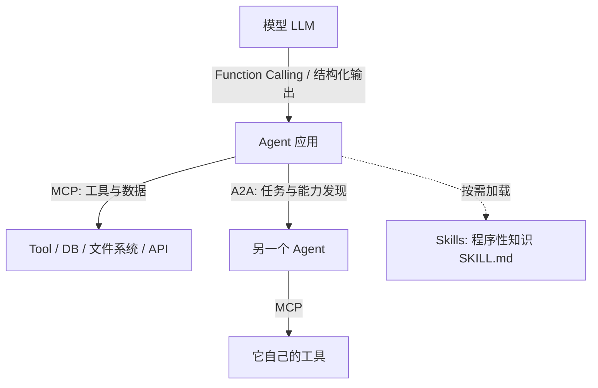

# 03 · 工具与协议

> 面试密度最高的一章。核心不是「会用 MCP」，而是**把 Function Calling / MCP / A2A / Skills 的边界画清楚**。

---

## 1. 一张分层图，先记住



| 概念 | 本质 | 类比 | 层次 |
|---|---|---|---|
| **Function Calling** | 模型按 Schema 输出 JSON，应用执行 | 螺丝刀 | 模型 ↔ 应用 |
| **MCP** | 标准化的工具/资源接入协议 | USB-C | Agent ↔ 工具与数据 |
| **Skills** | 自然语言写的「怎么做」+ 脚本，按需加载 | 使用说明书 | Agent ↔ 程序性知识 |
| **A2A** | Agent 间发现、认证、委派任务的协议 | HTTP | Agent ↔ Agent |

**一句话记牢**：MCP 管「Agent 连工具和数据」，A2A 管「Agent 找 Agent」，两者分层互补，不是竞争关系。

---

## 2. Function Calling 的完整链路

```
1. 定义工具：name / description / parameters(JSON Schema)
2. 把工具列表随请求发给模型
3. 模型输出 tool_calls（可能多个），应用校验 name 与 arguments
4. 应用本地执行函数（模型从不执行）
5. 结果以 role=tool + tool_call_id 回填
6. 再次请求模型，直到给出 final answer
```

### 工具 schema 怎么写，模型才选得对

- **动词化、单一职责**：`search_orders` 优于 `handle_data`；一个工具只做一件事。
- **description 写「何时用、何时不用、边界」**，比堆参数说明更有用。
- **参数少、类型简单、有 enum 约束**；避免深层嵌套 JSON、避免让模型生成精确 ID/行号。
- **返回内容精简且可解析**：给摘要 + 标识符，不要塞整页 HTML；大结果卸载到外部存储，只回引用（见 [04 章](../04-memory-and-context/README.md)）。
- **错误信息要能指导修正**：`参数 date 需为 YYYY-MM-DD，你给的是「明天」`，让模型下一轮能自己改对。

### 失败模式与工程处理

| 失败 | 处理 |
|---|---|
| 工具名幻觉 / 不存在 | 白名单校验，返回可用工具列表让模型重选 |
| 参数缺失、类型错、JSON 截断 | Schema 校验 → 把明确错误回填 → 有限重试（2–3 次）→ 降级 |
| Strict mode | 用 JSON Schema / grammar constrained decoding 从解码层保证格式 |
| 超时 / 长时间无响应 | 超时 + 熔断 + 幂等键，避免重复副作用 |
| 连续失败 | 指数退避 + 失败隔离 + 换路径或转人工 |
| 工具太多选不准 | 工具检索 / 分层目录 / 渐进式披露 / 按角色裁剪可见工具集 |

> **注意**：`temperature=0` 不能消除工具幻觉；它是概率生成 + 上下文稀释的结果，必须靠工程约束。

---

## 3. MCP（Model Context Protocol）

### 架构

```
Host（如 IDE / Agent 应用）
  └── Client（每个 Server 一个连接，1:1）
        └── Server（暴露 tools / resources / prompts）
```

### 三类能力

| 能力 | 谁控制 | 例子 |
|---|---|---|
| **Tools** | 模型决定调用 | 查数据库、发请求、写文件 |
| **Resources** | 应用/用户决定加载 | 文件内容、日志、知识片段（只读数据） |
| **Prompts** | 用户显式触发 | 预置的可复用提示模板 |

### 传输方式

- **stdio**：本地进程，Host 启动 Server 子进程，最常见于桌面/IDE 集成。
- **Streamable HTTP**（含 SSE 流式）：远程服务，需处理认证、会话、超时。
- 协议基于 **JSON-RPC 2.0**，有初始化握手与能力协商（`initialize` → `tools/list` → `tools/call`）。

### 它解决了什么、没解决什么

✅ 解决：N 个 Agent × M 个工具 的重复适配 → 变成 N + M；工具发现、描述、调用格式统一；生态可复用。
❌ 不解决：工具选得准不准、权限该不该给、结果可信不可信、模型会不会幻觉。**这些仍是应用层的责任。**

### 安全风险（面试加分项）

- 第三方 MCP Server 的**工具描述本身可以是注入载体**（描述里藏指令）。
- 过度授权：一个 Server 往往请求了远超需求的权限。
- 名称混淆 / 恶意同名工具（tool shadowing）、供应链风险。
- 应对：Server 白名单与来源审计、工具级权限最小化、调用前展示与确认、输出视为不可信数据、审计日志。

---

## 4. A2A（Agent2Agent）

- 由 Google 发起、现由 Linux Foundation 维护，解决**不同框架 / 不同厂商的 Agent 如何互操作**。
- **Agent Card**：JSON 描述能力、端点、认证方式 → 动态能力发现。
- **Task 模型**：任务有生命周期（submitted / working / completed / failed），支持 SSE 流式状态更新、长任务与人工介入。
- 基于 **HTTP + JSON-RPC 2.0**，Agent 之间不共享内部记忆、工具或私有逻辑（opaque）。
- 与 MCP 的组合：`用户 → 主 Agent --A2A→ 下单 Agent --MCP→ 库存 DB`。

> A2A **不替代 REST**：它补的是「动态能力发现 + 结构化任务委派」。

---

## 5. Skills：程序性记忆

- 一个 Skill 通常是一个文件夹：`SKILL.md`（说明、触发条件、步骤、检查清单）+ 可选脚本 / 参考资料。
- **渐进式披露**：默认只把 Skill 的名称与简介放进上下文，命中后才加载正文，再按需加载附件 → 显著省 token。
- **与 Tool 的边界**：Tool 定义「能做什么原子动作」，Skill 定义「按什么顺序把多个动作串起来」，粒度不同但都由自然语言驱动。
- 上百个 Skill 怎么管：目录索引 + 语义检索召回 Top-K + 分层加载 + 命中统计与淘汰。

| 对比 | Tool / MCP | Skill |
|---|---|---|
| 内容 | 确定性代码接口 + Schema | 自然语言指令 + 可选脚本 |
| 加载 | 工具描述常在上下文中 | 按需、渐进式 |
| 作用 | 提供能力 | 提供流程与 know-how |
| 失败表现 | 参数错、超时 | 流程走偏、步骤遗漏 |

---

## 6. 工具治理：从 demo 到生产

1. **分级**：只读 / 写入 / 高危（资金、删除、外发）分级，高危必须 HITL。
2. **最小权限**：按 Agent 角色裁剪可见工具，不是所有 Agent 都能访问所有 MCP。
3. **幂等**：有副作用的工具带 `idempotency_key`，重试不产生重复动作。
4. **审计**：每次调用记录 who / what / args / result / 耗时 / 会话 ID。
5. **沙箱**：代码执行、文件写入放在隔离环境中。
6. **不可信输入**：工具返回内容要与系统指令隔离，防止间接注入（见 [08 章](../08-safety-and-production/README.md)）。

---

## 7. 易错点与面试陷阱

| 常见错答 | 更准确的回答 |
|---|---|
| 「MCP 是 Function Calling 的升级版」 | 不同层：FC 是模型输出格式，MCP 是工具接入协议；用 MCP 时底层仍常是 FC |
| 「接了 MCP 模型就自动会用工具」 | MCP 只统一了描述与调用，选对工具仍靠 schema 设计、上下文与训练 |
| 「A2A 和 MCP 是竞品」 | Agent↔Agent vs Agent↔工具，生产系统常同时用 |
| 「Skills 就是一堆 prompt」 | 关键是按需加载机制与程序性记忆定位，以及它和 Tool 的粒度差异 |
| 「参数错了让模型重试就行」 | 需要校验 + 明确错误回填 + 有限次数 + 降级，且有副作用时要幂等 |
| 「工具越多能力越强」 | 工具描述挤占上下文、稀释注意力，选错率上升；要做检索与裁剪 |

---

## 8. 动手

| 文件 | 看什么 |
|---|---|
| [02_function_calling.py](../code/02_function_calling.py) | Schema 定义、非法参数校验、错误回填自修正、结果回填的完整闭环 |
| [05_mcp_server.py](../code/05_mcp_server.py) | 手写 JSON-RPC over stdio 的 MCP Server：`initialize` / `tools/list` / `tools/call` |
| [06_mcp_client.py](../code/06_mcp_client.py) | 客户端握手、能力发现、调用，理解「协议只是约定」 |

跑完试着回答：如果把 MCP Server 换成远程 HTTP，`tools/list` 的返回要怎么改才不会把上下文撑爆？

---

## 9. 高频面试题（附答题要点）

1. **Function Calling 原理？模型怎么知道调哪个工具？**
   → 工具 Schema 进入上下文 + 训练/微调学会该格式 + 解码约束；模型输出结构化参数，应用执行。
2. **返回的 Function Call 参数格式不对，工程上怎么处理？**
   → Schema 校验 → 具体错误回填 → 有限重试 → 降级/人工；有副作用时幂等。
3. **MCP 是什么，解决了什么问题？**
   → N×M 适配变 N+M；统一工具/资源发现与调用；JSON-RPC + 能力协商。
4. **MCP 的 Host / Client / Server 分别是什么？通信方式有哪些？**
   → Host 是应用，Client 与 Server 1:1；stdio 本地、Streamable HTTP 远程。
5. **MCP 和 Function Calling 的区别？**
   → 一个是接入协议（工具怎么被描述和暴露），一个是模型输出格式（怎么表达调用意图）。
6. **MCP Server 具体怎么开发？**
   → 实现 initialize / tools/list / tools/call 三个方法，声明 JSON Schema，处理错误码与超时。
7. **接入第三方 MCP Server 有什么风险？如何兼顾扩展性与安全性？**
   → 描述注入、过度授权、同名混淆、供应链；白名单、最小权限、审计、输出视为不可信。
8. **A2A 和 MCP 什么关系？多 Agent 通信协议怎么设计？**
   → 分层互补；Agent Card 发现、Task 生命周期、状态流、认证；也可用消息队列 + 结构化消息。
9. **MCP 和 Skills 有什么区别？Function Call / MCP / Skill 三者边界？**
   → 能力接口 / 接入协议 / 流程知识；粒度与加载方式都不同。
10. **Skill 的渐进式披露怎么实现？为什么能省 token？**
    → 默认只加载名称与简介，命中后加载正文与附件；避免把全部说明常驻上下文。
11. **注册上百个候选 Skill / 工具怎么处理？**
    → 索引 + 语义检索 + 分层目录 + 按角色裁剪 + 命中反馈淘汰。
12. **如何决定哪个 Agent 能访问哪些 MCP？**
    → 基于角色与任务的最小权限，运行时动态授予，高危工具单独审批。
13. **工具报错、长时间无响应、连续失败，重试与异常隔离怎么设计？**
    → 超时、指数退避、熔断、幂等键、失败隔离、备选路径、转人工。
14. **没有 MCP 之前多 Agent 协同怎么做？**
    → 应用内硬编码工具注册 + 模型输出约定的 JSON 分发；问题是每个 Agent 都要重复适配。
15. **大规模工具集下如何降低工具幻觉？**
    → 描述精简、命名清晰、检索召回 Top-K、分层、strict mode、白名单校验、失败反馈。

---

## 10. 本章必须记住的三句话

1. **Function Calling 是模型输出格式，MCP 是工具接入协议，A2A 是 Agent 间协议 —— 三个不同层。**
2. **工具返回的一切都是不可信输入，包括工具描述。**
3. **工具边界（能做什么、权限多大、返回什么）决定了 80% 的 Agent 行为，先设计边界再写提示词。**
