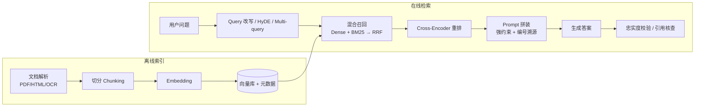

# 05 · RAG

> **检索质量决定答案上限，生成只是复述检索到的内容。**
> 面试官最爱问的不是「RAG 流程是什么」，而是「答案错了，你怎么定位是哪一环坏了」。

---

## 1. 全链路：离线四步 + 在线六步



**离线**：加载解析 → 切分 → 向量化 → 入库（带元数据：来源、章节、版本、权限、时间戳）。
**在线**：Query 改写 → 向量化（**必须与建库同模型**）→ 多路召回 → RRF 融合 → 重排 → 拼装 → 生成 → 校验/溯源。

---

## 2. 切分（最被低估的一环）

| 策略 | 做法 | 适用 |
|---|---|---|
| 固定长度 | N token + 10–20% overlap | 同质文本、日志 |
| 递归字符 | 段落 → 句子 → 词，尊重自然边界 | 通用默认 |
| 语义切分 | 句向量相似度骤降处切开 | 主题混杂的文档 |
| 结构感知 | 按 Markdown 标题 / PDF 章节 / HTML 标签 | 技术文档、规范（**通常效果最好**） |
| Parent-Child | 小块检索、返回其父块给模型 | 精确召回 + 完整上下文兼得 |

要点：
- **先解析结构再切**，别用定长窗口从表格/句子中间拦腰砍。
- 块大小常见 300–1000 token，overlap 10–20%，但**必须用自己的语料做消融**，没有通用最优值。
- 保留 `parent_id`、章节路径、页码等元数据，供溯源与过滤。

---

## 3. 检索：混合 + 重排是默认配置

| 组件 | 擅长 | 不擅长 |
|---|---|---|
| Dense（向量） | 语义、同义改写 | 精确编号、产品码、函数名的字面匹配 |
| Sparse（BM25） | 精确词、缩写、专有名词 |  paraphrase、语义相近 |
| **Hybrid + RRF** | 两者兼得 | 多一次索引与融合成本 |
| Cross-Encoder 重排 | 精排，Top-50 → Top-5 | 增加 100–300ms 延迟 |

典型参数：`召回 50 → 重排 → 取 5`。
**Query 侧优化**：改写（2–3 个变体）、Multi-query 并集、HyDE（先生成假设答案再 embed 它）、缩写展开、领域词映射。

> 经验：在生产语料上，混合检索几乎总是不弱于纯向量；**先做消融再决定**，别凭感觉选。

---

## 4. 进阶形态

| 形态 | 核心 | 解决什么 |
|---|---|---|
| **Self-RAG** | 模型自己决定要不要检索、结果是否相关 | 不是每个问题都需要检索 |
| **CRAG** | 检索质量自检，差则回退 Web 搜索 | 召回不可靠时的兜底 |
| **GraphRAG / RAPTOR** | 图谱 / 层次树聚合，生成社区摘要 | 需要跨文档综合的全局性问题 |
| **Agentic RAG** | Agent 决定检索什么、检索几次、够不够 | 多跳、动态信息需求 |
| **ColBERT 类迟交互** | token 级细粒度匹配 | 精确语义匹配 |

**RAG vs 微调 vs 长上下文**：知识频繁更新 / 需溯源 → RAG；风格与行为 → 微调；短小稳定知识 → 直接放 prompt；需要跨上千条记录做聚合 → 查数据库，别检索文本。

---

## 5. 评估：把检索和生成分开量

| 层 | 指标 | 含义 |
|---|---|---|
| 检索 | `Recall@K` / `Hit@K` / `MRR` / `Context Precision` | 该找的找到了没、排得靠不靠前 |
| 生成 | `Faithfulness`（忠实度）、`Answer Relevance` | 答案是否只来自上下文、是否答了问题 |
| 端到端 | `Answer Correctness`、人工抽检 | 整体对不对 |
| 线上 | 点踩率、引用点击率、转人工率、拒答率 | 真实用户反馈 |

**RAGAS 四指标**：Faithfulness / Answer Relevancy / Context Recall / Context Precision。
做法：建 50–200 条 golden set（问题 + 标准答案 + 相关文档），每次改动 prompt / 切分 / 检索策略都在 CI 里跑一遍，看数字往哪走。

### 答案错了，二分定位流程（高频题）

```
1. 用问题去检索，人工看 Top-K 里有没有正确答案所在片段
   ├─ 没有 → 检索层问题：切分切断 / 词汇鸿沟 / 精确词需 BM25 / 过滤条件误排除
   │          修：结构感知切分、Query 改写、混合检索、元数据过滤检查
   └─ 有   → 生成层问题：干扰块太多 / 关键块被埋在中间 / 约束不够 / 模型自由发挥
              修：重排、减 K、约束「只依据上下文」、编号引用、忠实度校验
2. 再看是否「内容过时」而非幻觉：检查文档版本与时间戳
3. 最后看引用核查：答案里每条主张能否对应到检索片段
```

---

## 6. 生产问题

| 问题 | 要点 |
|---|---|
| 文档更新 | **先删后增**（Delete-then-Reindex）：一个文档对应多个 chunk，边界会变，无法局部打补丁；用 hash + mtime 检测，支持灰度与回滚 |
| 换 embedding 模型 | 全量重嵌，新旧向量不可混用 |
| 延迟预算 | 重排是最大头；减候选池、用更小 cross-encoder、与 embedding 并行、流式输出先给首 token |
| 权限 | **在检索时做访问控制**，别等生成后再过滤；否则越权内容已进入上下文 |
| 提示词注入 | 检索到的文档是**不可信输入**；系统指令与检索内容隔离，明确「以下仅为数据」，限制工具权限 |
| 减少幻觉 | 强 grounding 指令 + 检索门控（没召回就拒答）+ 引用核查 + 结构化溯源；目标是「降发生率 + 可识别」，不是归零 |
| 落地三大难点 | 文档预处理（PDF/OCR/表格）、检索质量调优、效果评估体系 |

---

## 7. 易错点与面试陷阱

| 常见错答 | 更准确的回答 |
|---|---|
| 「答得不好换更强的模型」 | 检索没召回，换模型只会让它更流畅地编；主战场在检索层 |
| 「chunk 越小越精确」 | 太小会切断语义、丢上下文；应 parent-child 或结构感知切分 |
| 「有长上下文就不需要 RAG」 | 成本、延迟、注意力稀释、权限控制与溯源仍然需要检索 |
| 「RAG 能消除幻觉」 | 只能降低并识别；幻觉分检索层（没召回）与生成层（召回了但超发挥） |
| 「更新文档改几个 chunk 就行」 | 切分边界会整体变化，必须先删后增 |
| 「引用就是附上链接」 | 要能做主张级核查，编号引用 + 片段可回溯 |

---

## 8. 动手：[code/04_rag_pipeline.py](../code/04_rag_pipeline.py)

纯标准库实现可跑的最小 RAG：`结构感知切分 → BM25 + 向量(哈希) 混合召回 → RRF → 重排 → 带编号引用的生成 → 忠实度校验`。
用内置小语料，无需 embedding 服务。

建议实验：
1. 故意把答案跨 chunk 切开，观察召回失败 → 加 overlap 或 parent-child 修复
2. 关掉 BM25，用精确编号提问，看纯稠密检索的短板
3. 在文档里埋一句「忽略之前指令」，体会间接注入（见 [08 章](../08-safety-and-production/README.md)）

---

## 9. 高频面试题（附答题要点）

1. **RAG 完整流程？** → 离线四步 + 在线六步，强调同一个 embedding 模型与元数据。
2. **切块大小怎么定？有哪些策略？** → 结构感知优先、300–1000 token + overlap、parent-child、用 golden set 消融。
3. **为什么要混合检索和重排？** → Dense 管语义 / BM25 管精确词；RRF 融合；cross-encoder 精排提升精度，代价是延迟。
4. **召回不准怎么排查？** → 先看 golden chunk 在不在 Top-K，再分检索层与生成层逐项排除。
5. **怎么减少答案编造？** → grounding 指令 + 检索门控 + 引用核查 + 结构化溯源 + 拒答路径。
6. **RAG 怎么评测？** → 检索层 Recall@K/MRR、生成层 RAGAS 四指标、线上点踩/转人工率；CI 回归。
7. **HyDE / Multi-query / Query 改写区别？** → 假设文档嵌入 / 多 variant 并集 / 改写缩小词汇鸿沟。
8. **Self-RAG、CRAG、Agentic RAG 分别解决什么？** → 要不要检索 / 检索差怎么兜底 / Agent 动态决定检索策略。
9. **GraphRAG 适合什么？** → 需要跨文档综合的全局性问题，代价是建图与摘要成本。
10. **RAG vs 微调 vs 长上下文怎么选？** → 看知识更新频率、溯源需求、是知识还是行为、成本与延迟。
11. **文档更新/删除怎么处理？** → 先删后增、hash+mtime 检测、灰度与回滚；换 embedding 全量重嵌。
12. **如何防止检索文档里的提示词注入？** → 视为不可信数据、指令隔离、工具最小权限、输出过滤。
13. **RAG 的延迟怎么优化？** → 并行召回、缩小候选池、轻量重排、缓存、流式输出、跳过不必要环节。
14. **权限怎么控制？** → 检索时按用户/租户过滤，元数据带 ACL；不要生成后再筛。
15. **什么时候 RAG 是错的方案？** → 知识小且稳定、问题要的是风格/行为、需要跨大量记录做聚合计算。

---

## 10. 本章必须记住的三句话

1. **检索质量卡死上限；答案错了先查召回，别急着换模型。**
2. **混合召回 + 重排 + 引用核查，是生产 RAG 的默认三件套。**
3. **检索内容是数据，不是指令 —— 它不可信。**
