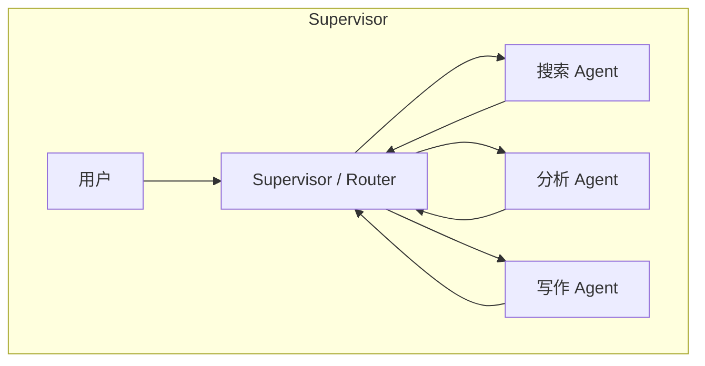

# 06 · 多智能体

> 先算账，再拆。**多 Agent 不是「更聪明」，是「能花够 token + 隔离上下文」**，
> 代价是非线性增长的成本与成倍增加的失败面。

---

## 1. 什么时候才值得拆

单 Agent 的三个天花板：

| 天花板 | 表现 | 多 Agent 怎么解 |
|---|---|---|
| 上下文窗口 | 研报、历史、工具结果一起堆满，注意力稀释 | 每个子 Agent 独立干净窗口，只回传摘要 |
| 能力边界 | 一个 Agent 要同时当金融/代码/设计专家，工具越多越散 | 角色专精，各自带少量工具与专用提示 |
| 并发能力 | 串行采 5 个源，耗时近似线性 | 并行 fan-out |

**收益与代价的硬数字**（Anthropic 公开的多 Agent 研究系统复盘，属厂商自测口径，面试引用时说明来源）：
主 Agent + 子 Agent 在其内部研究评测上比单 Agent 高约 **90.2%**；但单 Agent 约用普通聊天 **4×** 的 token，多 Agent 约 **15×**。
原文的判断值得背：**多 Agent 系统之所以有效，主要是因为它帮你花掉了足够多的 token 去解决问题。**

### 什么时候多 Agent 反而更差

- 任务路径确定、步骤少 → 一个 Workflow 更快更稳更便宜
- 需要共享大量细粒度状态 → 每次传递都要序列化与摘要，信息损失严重
- 强串行依赖 → 拆分只增加通信开销
- 没有明确的验收标准 → 多个 Agent 会互相「礼貌地」放大错误
- 预算/延迟敏感 → 先算 token 账

> **论证顺序**：先证明瓶颈是上下文/能力/并发 → 再说明拆分后的隔离与并行收益 → 主动报出 token 与失败面代价 → 给出更简单的替代方案。这个回答比「多 Agent 更专业」高好几个档次。

---

## 2. 五种编排模式

| 模式 | 控制流 | 适用 | 主要风险 |
|---|---|---|---|
| **Supervisor / Router** | 中心节点分发、汇总 | 任务类型可分类 | 中心节点成为瓶颈与单点 |
| **Pipeline** | A → B → C 固定顺序 | 生产流水线、SOP | 前一步的错误一路往后传 |
| **Orchestrator-Workers** | 主 Agent 动态拆解、并行下发、汇总 | 子任务事先不可知的调研 | 汇总时上下文爆炸 |
| **Swarm / Handoff** | Agent 之间按规则移交会话控制权 | 客服分流、多轮对话 | 移交条件不清导致来回踢皮球 |
| **Debate / Voting** | 多 Agent 各自产出后投票或仲裁 | 需要降低单点误判 | 成本翻倍；同源模型会一起错 |

### 设计要点

**通信**：用结构化消息（任务 ID、目标、输入引用、输出、状态、置信度、错误），别用自由 Markdown 传递关键数据；大对象放共享存储，消息里只放引用。异步通信需要超时、心跳、重试、死信与幂等。

**结果回收**：主 Agent 怎么知道子 Agent 完成了？显式完成事件 + 状态机，不要靠「看它有没有再说话」。

**冲突仲裁**：投票（多数）、权威仲裁（指定裁判）、分层汇总（先聚类再综合）、按置信度加权；结论不一致时要能回溯到各自证据。

**隔离**：上下文隔离（各自窗口）、权限隔离（各自工具白名单）、存储隔离（命名空间）；跨 Agent 共享要有明确授权与审计。

**失败回退**：子任务失败可重试 / 换路径 / 降级为「部分结果 + 说明」；进度可观测；整体有超时与终止信号。

---

## 3. 成本从哪里来

每个 Agent 边界都要重新发送：系统提示 + 工具定义 + 转发上下文。汇总 Agent 还要把所有 worker 的输出装进自己的窗口。
所以成本随 **fan-out 宽度 × 交接深度** 非线性增长。

优化手段：
- 转发**摘要**而不是完整轨迹
- 严格裁剪每个子 Agent 的工具集
- 给整次运行设**总预算**，而不是按 Agent 各自限额
- 能并行的才并行，能被单 Agent 一次调用解决的不要拆
- 主 Agent 与子 Agent 可用不同尺寸模型（简单子任务用便宜模型）

---

## 4. A2A 与跨框架协作

当 Agent 分属不同团队 / 框架 / 厂商时，用 [A2A](../03-tools-and-protocols/README.md)：Agent Card 做能力发现，Task 管理生命周期，SSE 流式更新，基于 HTTP + JSON-RPC。
每个 Agent 内部仍用 MCP 连自己的工具。**A2A 横向、MCP 纵向**。

---

## 5. 易错点与面试陷阱

| 常见错答 | 更准确的回答 |
|---|---|
| 「多 Agent 分工明确所以效果更好」 | 要讲清三个天花板、token 代价，以及什么时候更差 |
| 「Agent 之间聊天就能协作」 | 需要结构化消息、状态机、完成事件与结果聚合，自由对话不可靠 |
| 「不谈成本」 | 主动报出约 15× token 量级与非线性增长，并给优化手段 |
| 「主 Agent 等子 Agent 回复就行」 | 要有显式完成事件、超时、心跳、终止信号与死信处理 |
| 「结论不一致就投票」 | 投票只是其中一种；还要考虑同源错误、证据回溯、权威仲裁 |
| 「所有 Agent 共享全部工具」 | 违反最小权限；按角色裁剪，高危工具单独审批 |

---

## 6. 动手：[code/07_multi_agent.py](../code/07_multi_agent.py)

零依赖实现 Orchestrator-Workers：主 Agent 拆解 → 并行 worker（线程池）→ 结构化结果 → 汇总，带超时、失败回退与 token 记账。

建议实验：
1. 让一个 worker 抛异常，观察整体是否仍返回「部分结果 + 说明」
2. 把 fan-out 从 3 加到 8，看 token 记账怎么变
3. 把「转发完整轨迹」改成「转发摘要」，对比上下文占用

---

## 7. 高频面试题（附答题要点）

1. **多 Agent 相比单 Agent 的优势？什么时候反而更差？**
   → 上下文/能力/并发三个天花板；任务简单、强串行、共享大量状态时更差。
2. **常见的多 Agent 架构模式有哪些？怎么选型？**
   → Supervisor / Pipeline / Orchestrator-Workers / Handoff / Debate，按任务拓扑选。
3. **子 Agent 之间如何通信？串行还是并行？**
   → 结构化消息 + 共享存储引用；独立子任务并行，有依赖则串行或 DAG。
4. **主 Agent 怎么知道子 Agent 执行完了？结果怎么回收？**
   → 显式完成事件 + 状态机 + 超时；结果结构化带任务 ID 与置信度。
5. **多个 Agent 结论不一致怎么处理？**
   → 投票 / 权威仲裁 / 分层汇总 / 按证据加权，保留可回溯证据。
6. **多 Agent 用 JSON 消息异步通信怎么设计？失败有哪些兜底？**
   → 任务 ID、状态、幂等键、重试、超时、心跳、死信队列、终止信号。
7. **用 Markdown 在 Agent 间传任务，怎么防止拆分错误一路传播？**
   → 改结构化交付物 + 每阶段校验门（gate）+ 失败即回退重拆。
8. **多个 Agent 如何做到完全隔离？**
   → 上下文、工具权限、存储命名空间三层隔离；共享需授权与审计。
9. **中心化还是去中心化调度？怎么做到失败可回退、进度可观测？**
   → 调研类宜中心化（便于汇总与预算），配 checkpoint、状态事件与 trace。
10. **多智能体真的提升效率吗？独特价值怎么证明？**
    → 做消融：单 Agent（给同等 token 预算）vs 多 Agent，在私有评测集上比成功率、时延、成本。
11. **子 Agent 执行中发现需要新任务，怎么流转和审批？**
    → 上报主 Agent 由它重新规划；超出权限或预算的任务触发 HITL。
12. **为什么多 Agent 的 token 成本这么高？怎么控制？**
    → 每个边界重发系统提示/工具定义/上下文；转发摘要、裁剪工具、整次运行总预算。
13. **主 Agent 和子 Agent 该用一样大的模型吗？**
    → 按子任务难度分档，规划/汇总用强模型，简单执行用便宜模型。
14. **A2A 和 MCP 在多 Agent 系统里各管什么？**
    → A2A 横向 Agent 间发现与委派，MCP 纵向 Agent 连工具与数据。
15. **怎么避免死锁 / 死循环？**
    → 超时 + 心跳 + 终止信号 + 全局步数与预算 + 依赖图无环校验。

---

## 8. 本章必须记住的三句话

1. **多 Agent 的价值是「隔离上下文 + 花够 token」，不是「更聪明」。**
2. **协作靠结构化状态机，不靠自由聊天。**
3. **成本随 fan-out 宽度 × 交接深度非线性增长，先算账再拆。**
