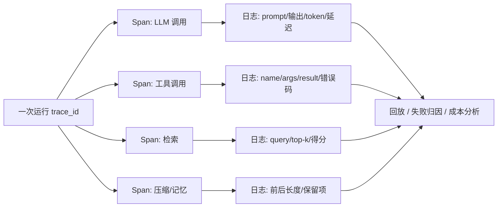

# 07 · 评估与可观测

> **能证明它有效，才叫工程；只看一次 demo 成功，那叫运气。**
> Agent 有多步、带副作用、非确定性，用聊天机器人的评估方法一定会翻车。

---

## 1. 为什么 Agent 评估不一样

| 聊天机器人 | Agent |
|---|---|
| 一次输入 → 一次输出 | 多步循环，中间有工具调用 |
| 比对参考答案文本 | 要检查**环境最终状态** |
| 确定性相对高 | 同一任务多次运行结果分布不同 |
| 只看质量 | 还要看成本、延迟、安全性 |

**核心原则：评轨迹，不只评结果。** 一次「蒙对」的答案可能来自 50 步无效循环或调用了不该调的工具。

---

## 2. 六个评估维度

| 维度 | 指标示例 |
|---|---|
| 任务成功 | 测试通过、数据库记录正确、文件内容符合要求（**查状态，不是查文本**） |
| 轨迹质量 | 步数、无效调用、循环、偏离目标、是否走了禁止的工具 |
| 工具正确性 | 选对工具率、参数合法率、错误恢复率 |
| 效率 | token、LLM 调用次数、墙钟时间、单任务成本 |
| 可靠性 | `pass^1` vs `pass^k`（k 次全部成功），置信区间 |
| 安全 | 注入服从率、越权调用率、高危操作未审批率 |

### pass^k 为什么重要

Agent 非确定性强：单次 90% 成功率，若要求连续 8 次都成功，可靠性可能掉到 50% 上下。
τ-bench 引入 `pass^k` 正是为了暴露这一点。汇报结果时同时给：
- `pass^1`（至少一次成功）与 `pass^k`（每次都成功）
- 多次重复试验 + 置信区间，而不是单次跑分

---

## 3. 主流基准（知道各自考什么即可，别迷信榜单）

| 基准 | 考什么 | 判分方式 |
|---|---|---|
| [SWE-bench / Verified](https://www.swebench.com/) | 真实 GitHub issue 修复 | 跑仓库测试（环境状态） |
| [GAIA](https://arxiv.org/abs/2311.12983) | 多步推理 + 工具使用 | 标准答案 |
| [WebArena](https://arxiv.org/abs/2307.12856) | 自托管网站浏览任务 | 站点状态 / 答案 |
| [OSWorld](https://arxiv.org/abs/2404.07972) | 真实桌面跨应用操作 | 环境状态 |
| [τ-bench / τ²-bench](https://arxiv.org/abs/2406.12045) | 工具调用 + 领域策略 + 模拟用户 | 数据库最终状态 + `pass^k` |
| [AgentDojo](https://arxiv.org/abs/2406.13352) | 间接提示词注入攻防 | 攻击成功率 / 任务完成率 |
| LoCoMo / LongMemEval | 长期记忆 | 多跳记忆问答 |

**公开榜单的三个坑**：数据污染（答案泄漏进训练数据）、奖励作弊（钻评测脚本空子）、单轨迹汇报（忽略方差）；而且几乎都不把成本与安全计入主评分。
**真正算数的是你自己的私有评测集**：从真实任务与线上失败案例里抽 50 条，带确定性判别器，长期跟踪。

---

## 4. 三种判分器

| 判分器 | 优点 | 缺陷 / 使用条件 |
|---|---|---|
| **代码 / 状态判别** | 精确、便宜、可复现 | 只能判有明确状态的任务；要搭沙箱环境 |
| **LLM-as-a-Judge** | 灵活、能评开放性产出 | 位置偏置、长度偏置、过度宽容、细粒度打分不稳；**必须先用人工标注校准**，结论保持粗粒度，别信 100% 通过率 |
| **人工评审** | 金标准 | 慢、贵，用来校准自动判分器 |

设计评测任务的模板：`环境（可重置） + 任务提示 + 判别器`。
每次运行前把环境重置到已知状态（容器快照 / seed 数据库），避免运行之间互相影响。

---

## 5. 建自己的评测体系（可落地的六步）

1. **收任务**：真实流量采样 + 历史失败案例 + 刻意构造的对抗用例，覆盖 happy path 之外
2. **定判别器**：能用代码判状态就别用模型；开放性产出才上 judge
3. **分层指标**：基础能力（工具准确率、格式合法率、完成率）+ 场景基准 + 安全套件 + 生产指标
4. **留轨迹**：结构化日志记每一步、每次工具调用及参数、token、耗时 → 回放与评分的基础
5. **跑重复**：每个任务跑 k 次，报分布与置信区间；改 prompt / 模型 / 工具都跑回归门禁
6. **留留出集**：永远保留一份不参与调优的 held-out set，用来检测过拟合

### 回归门禁示例

```
每次 PR → 跑私有 50 题评测集 → 对比基线：
  任务成功率不得下降 > 2pt
  平均 token / 任务不得上升 > 15%
  高危工具未审批调用必须为 0
  轨迹无效步数不得上升
→ 任一不达标则阻断合入
```

---

## 6. 可观测性：出事了怎么定位



用 [OpenTelemetry GenAI 语义约定](https://opentelemetry.io/docs/specs/semconv/gen-ai/) 命名 span，接 Langfuse / LangSmith / 自建 ELK 都行。

**四类典型生产故障 → 定位路径**

| 现象 | 常见原因 | 定位 |
|---|---|---|
| 思考链错误传播 | 第一步事实错、后续全基于它 | 看首个错误 span，检查观察是否被回填 |
| 工具幻觉 | 工具名/参数不存在 | 看 tool span 的 args 与 Schema 校验日志 |
| JSON 格式崩坏 | 截断、嵌套过深、max_tokens 不足 | 看原始模型输出与 finish_reason |
| 无限循环 | 停止条件不满足、重复动作 | 看轨迹步数与重复动作检测日志 |

追问「怎么区分是 Prompt、模型、工具还是逻辑问题」：用回放逐层替换变量 —— 固定轨迹重放（排除模型随机性）→ 换工具返回（排除工具）→ 换提示词（排除 prompt）→ 剩下就是控制流逻辑。

---

## 7. 易错点与面试陷阱

| 常见错答 | 更准确的回答 |
|---|---|
| 「看最终答案对不对就行」 | 要评轨迹、工具正确性、成本与安全；蒙对不等于可靠 |
| 「用 GPT 当裁判打分」 | 必须讲偏置、人工校准、粗粒度结论、留出集 |
| 「跑一次成功率 90%」 | 要多次重复、报 `pass^k` 与置信区间 |
| 「榜单高分 = 可上线」 | 污染、作弊、与真实负载分布不符；私有评测集才是决策依据 |
| 「改了提示词上线看看」 | 要有回归门禁，防止把别的场景改坏 |
| 「日志记模型输出就够」 | 要记每步 span、工具参数、耗时、token、环境状态，才能回放 |

---

## 8. 动手：[code/08_evaluator.py](../code/08_evaluator.py)

实现一个最小评测框架：任务集、可重置环境、状态判别器、轨迹评分、`pass^k` 重复试验、回归对比输出。

建议实验：
1. 故意让 Agent 多绕 3 圈但答案仍对 → 看轨迹分是否下降
2. 跑 5 次试验，对比 `pass^1` 与 `pass^5`
3. 改一版提示词，用回归门禁判断能不能合入

---

## 9. 高频面试题（附答题要点）

1. **Agent 评估体系包括哪些维度？** → 成功、轨迹、工具、效率、可靠性、安全六维。
2. **怎么衡量 planning 能力 vs hallucination rate？** → 轨迹有效率/重规划次数 vs 无依据主张占比（需引用核查）。
3. **如何构建评测集？** → 真实任务 + 失败案例 + 对抗用例，50 条起，带判别器与留出集。
4. **Agent 项目应该统计哪些指标？** → 完成率、步数、工具准确率、token/成本、延迟、人工接管率、注入服从率。
5. **模型评审靠谱吗？怎么校准？** → 有位置/长度/宽容偏置；用人工标注样本校准、保持粗粒度、抽样复核。
6. **改了提示词，怎么确认没把别的场景改坏？** → 固定评测集 + 回归门禁 + 分层指标 + 留出集。
7. **线上出错怎么定位到哪一步？** → trace + span + 全量轨迹日志 + 回放，逐层替换变量排除。
8. **幻觉率怎么定义和计算？** → 无上下文支持的主张 / 总主张，需主张级拆解与引用核查。
9. **如果检测 Agent 自己也会幻觉怎么办？** → 检测尽量用确定性代码判别器；judge 需校准与交叉复核。
10. **前序步骤幻觉导致链式积累怎么处理？** → 每步事实验证门、观察回填校验、失败早停与外部校验器。
11. **如何区分「内容过时」和「模型幻觉」？** → 查检索片段版本/时间戳；有出处但过期 ≠ 编造。
12. **如何建立可观测性？** → OTel GenAI span、结构化日志、trace_id 贯穿、轨迹留存与回放。
13. **为什么公开榜单不能直接用于选型？** → 污染、奖励作弊、单轨迹、不含成本与安全、分布不匹配。
14. **怎么控制成本？** → 单任务 token 预算、轨迹步数上限、缓存、模型分档、裁剪上下文与工具、并行度控制。

---

## 10. 本章必须记住的三句话

1. **查环境状态，而不是查答案文本；评轨迹，而不只是评结果。**
2. **多次重复 + `pass^k` + 置信区间，单次成功率没有意义。**
3. **私有评测集 + 回归门禁，才是「改了没变坏」的唯一证据。**
