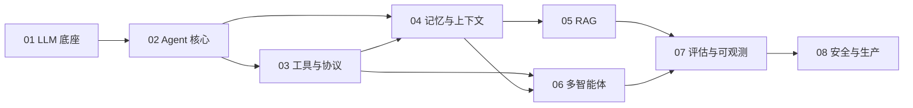

# 学习路线与掌握标准

> 一句话原则：**先手写，再用框架；先讲清边界，再谈选型。**
> 面试官不考你背了多少名词，考的是「为什么这样设计、换你会怎么改、出错了怎么定位」。

---

## 阶段依赖图

`01 → 02 → 03` 是主干，其余章节可以按面试岗位侧重点并行推进。
只准备「大模型应用开发岗」时，`01 / 02 / 03 / 05 / 07` 权重最高；
准备「Agent 平台 / Harness 岗」时，`04 / 06 / 08` 权重最高。

---

## 阶段清单

### 01 · LLM 底座 — 建立正确的物理直觉

| 项 | 内容 |
|---|---|
| 目标 | 知道模型在算什么、钱花在哪、为什么会胡说 |
| 知识点 | Tokenization 与 BPE；Self-Attention / QKV / 缩放；RoPE；MHA→GQA→MQA；KV Cache；temperature / top_p / 重复惩罚；预训练 / SFT / RLHF / DPO / GRPO；LoRA / QLoRA；量化、投机解码、PagedAttention、连续批处理；结构化输出与 Function Calling 的训练来源 |
| 动手 | 手算一次 scaled dot-product attention；用 `transformers` 打印 KV Cache 尺寸随序列增长 |
| 掌握判定 | 能解释「为什么上下文变长后效果会变差，而不只是变贵」；能说清 Function Calling 本质是受约束的结构化生成，不是模型真的执行了函数 |
| 常见坑 | 只背「LoRA 省显存」，答不出低秩假设；把 temperature=0 当成「不会幻觉」 |

### 02 · Agent 核心 — 把循环讲透

| 项 | 内容 |
|---|---|
| 目标 | 能徒手写出最小可用 Agent，并说清每一行为什么存在 |
| 知识点 | Agent vs Workflow 的判定标准；augmented LLM；ReAct 的 Thought/Action/Observation；CoT / ToT / Reflexion；Plan-and-Execute 与 RePlan；Agent Loop 的状态机；停止条件三层防护；Anthropic 五种工作流模式；ACI（Agent-Computer Interface） |
| 动手 | [code/01_minimal_react_agent.py](code/01_minimal_react_agent.py)：不依赖框架实现完整循环 |
| 掌握判定 | 合上文档能写出 30 行内的 loop；能回答「除了工具调用，最小 Agent 还必须有什么」 |
| 常见坑 | 把「最大轮次」当成唯一防死循环手段；说不出何时不该用 Agent |

### 03 · 工具与协议 — 面试密度最高的一章

| 项 | 内容 |
|---|---|
| 目标 | 把 Function Calling / MCP / A2A / Skills 的边界画清楚 |
| 知识点 | Tool schema 与 JSON Schema；strict mode / constrained decoding；参数非法与重试；工具描述写法；大规模工具集检索与渐进式披露；MCP 的 Host / Client / Server、tools / resources / prompts、stdio 与 Streamable HTTP；A2A 的 Agent Card 与任务模型；Skill 与 Tool 的粒度差异；权限最小化 |
| 动手 | [02_function_calling.py](code/02_function_calling.py)、[05_mcp_server.py](code/05_mcp_server.py)、[06_mcp_client.py](code/06_mcp_client.py) |
| 掌握判定 | 能画出一次工具调用从模型输出到结果回填的完整链路；能解释「MCP 和 Function Calling 不是替代关系」 |
| 常见坑 | 认为 MCP 会让模型自动更聪明；把 Skills 说成「就是一堆 prompt」而不讲加载机制 |

### 04 · 记忆与上下文 — 2026 年的重灾区

| 项 | 内容 |
|---|---|
| 目标 | 把上下文当成「有预算、有生命周期的资源」来设计 |
| 知识点 | 短期 / 长期 / 情景 / 语义 / 程序性记忆；Messages List 才是真实记忆；context rot 与 lost-in-the-middle；滑动窗口、摘要压缩、结构化笔记、子 Agent 隔离、just-in-time 检索；工具结果卸载；压缩保真；记忆写入与召回策略、冲突与遗忘、可删除性 |
| 动手 | [03_memory.py](code/03_memory.py) |
| 掌握判定 | 能回答「压缩放在链路哪一步、怎么保证不丢关键内容」；能区分上下文污染与工具污染 |
| 常见坑 | 把「长期记忆 = 向量库」当标准答案；忽略权限与隐私、忽略"用户要求删除记忆" |

### 05 · RAG — 检索质量决定上限

| 项 | 内容 |
|---|---|
| 目标 | 能从故障现象反推是哪个环节坏了 |
| 知识点 | 离线索引四步 / 在线检索六步；结构感知切分与 parent-child；稠密 / BM25 / 混合 + RRF；cross-encoder 重排；Query 改写、Multi-query、HyDE；Self-RAG / CRAG / GraphRAG / Agentic RAG；引用与溯源；RAGAS 四指标与 Hit@K / MRR；检索注入防护；RAG vs 微调 vs 长上下文 |
| 动手 | [04_rag_pipeline.py](code/04_rag_pipeline.py)：纯标准库实现可跑的最小检索链路 |
| 掌握判定 | 面对「答案错了」，能给出一套二分定位流程：先看召回、再看拼装、最后看生成 |
| 常见坑 | 一上来换更强的大模型；忽略检索内容是不可信输入 |

### 06 · 多智能体 — 先算账，再拆

| 项 | 内容 |
|---|---|
| 目标 | 能论证「为什么这里需要多 Agent」，也能论证「为什么不需要」 |
| 知识点 | 单 Agent 三个天花板（上下文 / 能力 / 并发）；Supervisor、Pipeline、Orchestrator-Workers、Swarm / Handoff、Debate；共享状态与消息传递；结果聚合与冲突仲裁；失败回退、超时、心跳、终止信号；上下文与权限隔离；token 成本非线性增长 |
| 动手 | [07_multi_agent.py](code/07_multi_agent.py) |
| 掌握判定 | 能说清「多 Agent 主要价值是花够 token + 隔离上下文」，并说明代价与替代方案 |
| 常见坑 | 把「多个 Agent 聊聊天」当成协作；不谈成本、不谈失败回退 |

### 07 · 评估与可观测 — 区分 demo 与产品

| 项 | 内容 |
|---|---|
| 目标 | 能设计评测集，并用数据证明一次改动是变好还是变坏 |
| 知识点 | 结果评估 vs 轨迹评估；SWE-bench / GAIA / WebArena / OSWorld / τ-bench / AgentDojo；pass^k 与重复试验；LLM-as-judge 的偏置与校准；代码判别器；私有评测集；tracing / span / 回放；成本、延迟、人工接管率；回归门禁 |
| 动手 | [08_evaluator.py](code/08_evaluator.py) |
| 掌握判定 | 能回答「改了提示词，怎么确认没把别的场景改坏」 |
| 常见坑 | 只看单次成功率；迷信公开榜单；把 judge 的 100% 通过率当结论 |

### 08 · 安全与生产 — 决定能不能上线

| 项 | 内容 |
|---|---|
| 目标 | 把模型的不确定性关进工程笼子 |
| 知识点 | 直接 / 间接提示词注入；最小权限、工具分级与沙箱；HITL 的暂停与恢复；有副作用工具的幂等与审计；重试 / 超时 / 熔断 / 降级；checkpoint 与断点恢复；四类典型故障（思考链错误传播、工具幻觉、JSON 崩坏、无限循环）；成本与延迟治理；PII 与数据隔离 |
| 动手 | [09_guardrails.py](code/09_guardrails.py) |
| 掌握判定 | 能给出「高危操作」的完整管控方案，而不是只说「加个人工审核」 |
| 常见坑 | 把安全当成提示词里加一句「不要做坏事」；忽略连续认证 |

---

## 三种节奏

| 节奏 | 适用 | 做法 |
|---|---|---|
| **突击（约 2 周）** | 已有项目经验，临面试 | 直通 [INTERVIEW.md](INTERVIEW.md)，不会的题回查对应章节；代码只跑 01 / 02 / 04 |
| **系统（约 6 周）** | 转岗 / 校招 / 想真正掌握 | 按 01→08 顺序，每章完成「读 + 跑 + 写 + 答 + 讲」五步，用 [CHECKLIST.md](CHECKLIST.md) 记录 |
| **深挖（长期）** | 想做 Agent 平台 / 研究 | 每个知识点回到 [RESOURCES.md](RESOURCES.md) 的一手论文，追一版实现与一版评测 |

## 面试前 3 天

1. 用 [CHECKLIST.md](CHECKLIST.md) 找出所有没打勾的项，只补这些
2. 准备 **2 个项目故事**，每个都能回答：为什么用 Agent、怎么评估、出过什么故障、怎么定位、成本多少
3. 把 [INTERVIEW.md](INTERVIEW.md) 的系统设计题限时 15 分钟手写一遍架构
4. 复述三句话：**路径确定用 Workflow，路径不确定才用 Agent**；**上下文是预算不是容器**；**评估轨迹而不只是结果**

## 最常见的四个误区

- ❌ 刷框架 API，不讲底层协议 → 追问两句就露馅
- ❌ 只准备「是什么」，不准备「你们项目里怎么做」 → Agent 岗面试的必杀追问
- ❌ 只背 2024 年八股 → 2026 高频考点已经是 Harness、上下文工程、Skills、评测
- ❌ 只看不写 → 建议每个知识点都用自己的话写一段，写不出就是没掌握
